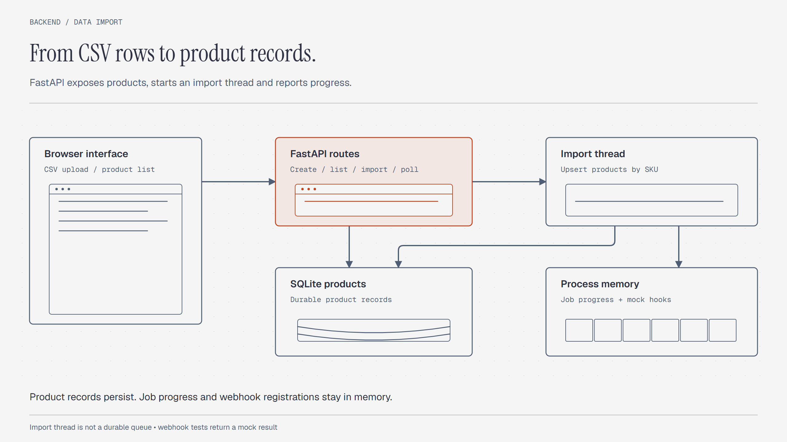

# Fullhooker

A FastAPI demonstration for product records, CSV imports, and a mock webhook manager. The browser interface displays products and polls import progress.

## System design



FastAPI stores product records in SQLite through SQLAlchemy. Each CSV upload starts a Python thread.
Import progress and webhook registrations remain in process memory.

## Run locally

Use Python with `venv` support. Run these commands from the repository root:

```sh
python -m venv .venv
```

Activate the environment:

```powershell
# Windows PowerShell
.venv\Scripts\Activate.ps1
```

```sh
# Linux or macOS
source .venv/bin/activate
```

Install the dependencies and start one API process:

```sh
python -m pip install -r requirements.txt
python -m uvicorn backend.app:app --reload --host 127.0.0.1 --port 8000
```

Open `http://127.0.0.1:8000/docs` for the API interface.
The database appears as `products.db` in the current directory.

For the browser page, change `apiBase` in `index.html` to `http://127.0.0.1:8000`.
The checked-in value points to an earlier Render deployment. Serve the page in another terminal:

```sh
python -m http.server 8080
```

Open `http://127.0.0.1:8080/index.html`. Use the API documentation URL above, since the page's `/docs` button uses its own origin.

## Import a CSV file

Use these column names:

```csv
sku,name,price,stock
DEMO-001,Sample product,12.50,20
DEMO-002,Second product,8.00,5
```

The importer updates an existing product when its SKU matches. Otherwise, it creates a product.
Each row commits separately. The interface polls `/progress/{job_id}` for completion percentage.

## API

| Method | Path | Behavior |
|---|---|---|
| GET | `/products` | List products |
| POST | `/products` | Create a product |
| POST | `/upload-csv` | Accept multipart field `file` and return a job identifier |
| GET | `/progress/{job_id}` | Return an in-memory progress value |
| POST | `/webhook/register?url=...` | Register a URL in memory |
| POST | `/webhook/test?url=...` | Return a mock delivery result |

Product fields are `sku`, `name`, `price`, and `stock`. The database enforces unique SKUs.
There are no product update or delete routes.

## File map

| File | Responsibility |
|---|---|
| `backend/app.py` | API routes and database-session dependency |
| `backend/database.py` | SQLite engine and session factory |
| `backend/models.py` | Product table |
| `backend/schemas.py` | Product request and response models |
| `backend/csv_importer.py` | CSV parsing and SKU-based updates |
| `backend/workers.py` | Import thread creation |
| `backend/utils/progress_store.py` | Import percentages |
| `backend/webhook.py` | In-memory registrations and mock delivery |
| `index.html` | Browser interface |
| `requirements.txt` | Python dependencies |

The original task document and text architecture sketch remain in the repository.

## Current limits

This is a scoped prototype. Webhook tests do not send HTTP requests.
Progress and registrations disappear when the process stops. They do not synchronize across API workers.
The thread receives the request's upload object and database session, which can create lifecycle problems.
There is no durable queue, retry system, authentication layer, or completed load test in this repository.

## License

[MIT](LICENSE) covers original code and documentation by Velan E.
The supplied assessment document remains outside that grant. See [LICENSING.md](LICENSING.md).
